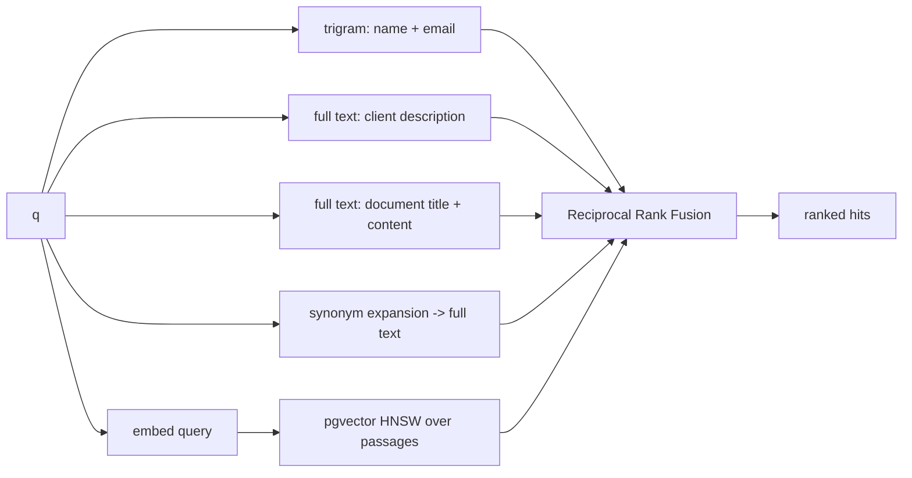

# Search

Code: `src/nevis_search/search/`. Retrievers are in `retrievers.py`, fusion in `fusion.py`, orchestration and caching in `service.py`.

Five retrievers run inside one Postgres transaction, each producing a ranked list:

| Retriever | Finds | Postgres feature |
|---|---|---|
| `name`, `email` | `NevisWealth` in `john.doe@neviswealth.com`, `Jonh Doe`, `nevis` | `pg_trgm` `word_similarity` (`<%` operator, GIN trigram index on a generated column) |
| `description` | `surgeons` in "Retired orthopaedic surgeon" | `tsvector` generated column, English stemming, GIN index |
| `keyword` | stemmed terms in document title (weight A) and content (weight B) | `plainto_tsquery`, `ts_rank_cd` |
| `synonym` | `address proof` -> utility bill, bank statement, tenancy agreement, council tax bill | query expansion from [`synonyms.txt`](../src/nevis_search/search/synonyms.txt), `phraseto_tsquery` |
| `semantic` | `selling the company` -> share purchase agreement | `pgvector` cosine distance, HNSW index, best passage per document |

Every retriever treats the query as plain text, with no boolean or phrase operators. So `-pension` searches for "pension"; it doesn't trigger a full scan for everything without the word.

The lists are merged with Reciprocal Rank Fusion: `score = sum(1 / (60 + rank))`. The retrievers' raw scores (trigram similarity, `ts_rank_cd`, cosine distance) aren't comparable, and RRF needs no normalisation across them. A hit that several retrievers agree on rises to the top. Scores are rank-based: they order results, they are not probabilities. Hits with tied scores are ordered by id.

## Why there is a synonym retriever

The brief's own example, "address proof" should find "utility bill", is domain knowledge (KYC rules for proof of address), not general language similarity. Before designing the pipeline I measured six local embedding models on a small KYC corpus. None ranked the utility bill first for "address proof"; most ranked the passport higher:

| Model (fastembed) | Dim | Rank of the utility bill for "address proof" | Top hit |
|---|---|---|---|
| BAAI/bge-small-en-v1.5 | 384 | 2 | passport |
| BAAI/bge-base-en-v1.5 | 768 | 3 | passport |
| mixedbread-ai/mxbai-embed-large-v1 | 1024 | 2 | passport |
| nomic-ai/nomic-embed-text-v1.5 | 768 | not in top 5 | council tax bill |
| snowflake/snowflake-arctic-embed-s | 384 | not in top 5 | meeting notes |
| sentence-transformers/all-MiniLM-L6-v2 | 384 | 1 (by 0.005) | utility bill |

So equivalences like this live in a curated synonym file, the same mechanism as Elasticsearch synonym graphs.

* **Triggering:** a query triggers a group when it contains every stemmed word of one of the group's terms (`to_tsvector(q) @@ plainto_tsquery(term)`). So "proof of addresses" and "address proof" both trigger the proof-of-address group.
* **Expansion:** the triggered group's terms are OR-ed into an extra full-text query.
* **The file:** plain text, one comma-separated group per line, validated at startup.
* **Guard:** a test fails if any multi-word term collapses to a single word after Postgres stopword removal. For example "last will" would become just "last".

Embeddings still handle open-ended paraphrase ("selling the company", "who is moving to Switzerland").

## Semantic retrieval

* **Passages:** documents are split into passages of up to 120 words on sentence boundaries, with one sentence of overlap. Each passage is embedded together with the document title. A single vector per document would silently ignore everything past the model's 512-token window.
* **Model:** `BAAI/bge-small-en-v1.5` (384 dimensions, 67 MB, ONNX via `fastembed`) runs in-process, with no API key and no network at runtime. The model is baked into the Docker image.
* **Cutoff:** `SEMANTIC_MIN_SIMILARITY=0.60`, calibrated on the seed corpus. bge-small cosine scores are compressed: unrelated passages score 0.45-0.50 and relevant ones 0.60-0.75. At 0.60 every nonsense query returns nothing (max 0.496), and the top relevant passage is kept for 11 of 12 test queries. The miss ("address proof") is covered by the synonym retriever.
* **Filtering:** the query sets `hnsw.iterative_scan = relaxed_order`, so filtering by `client_id` doesn't starve the approximate index scan.

## Snippets

Lexical matches get a `ts_headline` fragment with the matched words wrapped in `<mark>`; semantic-only matches show the best passage.

Highlighting uses sentinel characters, which are first stripped from the stored content. The text is then HTML-escaped and only afterwards are the sentinels turned into `<mark>` tags. A snippet can therefore be rendered as HTML without letting stored content inject markup.
